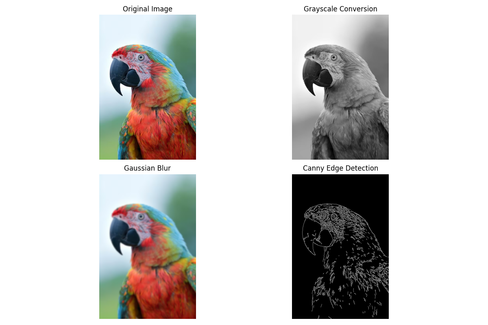

# Image Processing with Python: A Comparative Analysis of Image Enhancement Techniques

**Course:** ITT440 – Network Programming  
**Topic:** Image Processing with Python  
**Student:** Ahmad Safi Bin Mohd Aznan  
**Student ID:** 2025144435

---

## 1. Introduction

Image processing is the process of modifying and analyzing digital images using computer programs. Python is commonly used for image processing because it provides libraries such as OpenCV, NumPy, and Matplotlib.

This article focuses on three image-processing techniques: **Grayscale Conversion, Gaussian Blur, and Canny Edge Detection**. Grayscale conversion changes a color image into shades of gray, Gaussian blur reduces image details by smoothing, and Canny edge detection identifies object boundaries.

The purpose of this project is to demonstrate these techniques using Python and compare their results using the same input image.

## 2. Objectives

1. Explain the basic concepts of image processing using Python.
2. Demonstrate grayscale conversion, Gaussian blurring, and Canny edge detection with OpenCV.
3. Compare the outputs of the three techniques using the same photograph.
4. Explain how processing parameters affect image appearance and detail.
5. Document a reproducible program and its observed output for a GitHub article and video demonstration.

## 3. System and Software Requirements

The demonstration was carried out on a MacBook using VS Code and a Python virtual environment.

| Component | Environment used |
|---|---|
| Operating system | macOS |
| Code editor | Visual Studio Code |
| Python | 3.9.6 |
| OpenCV | 4.11.0.86 (`opencv-python`) |
| NumPy | 1.26.4 |
| Matplotlib | 3.9.4 |
| Input | `sample.jpg` (parrot photograph) |
| Output | A four-panel display and `results.png` |

### 3.1 Installation

In the VS Code terminal, create and activate a virtual environment, then install the compatible packages:

```bash
python3 -m venv .venv
source .venv/bin/activate
python -m pip install "opencv-python==4.11.0.86" "numpy==1.26.4" "matplotlib==3.9.4"
```

Place `sample.jpg` and `image_processing.py` in the same project folder. The image used in this demonstration was converted from AVIF to JPEG before running the script. Converting the file format, rather than simply renaming the extension, ensures the input is a valid JPEG.

## 4. Methodology

The program reads one source photograph and produces three separate processed versions. Keeping the source constant makes it easier to compare what each operation changes.

1. Load `sample.jpg` with `cv2.imread()`.
2. Convert the BGR image to RGB for accurate color display with Matplotlib.
3. Convert the original BGR image to grayscale.
4. Apply a **15 × 15 Gaussian blur to the RGB image**, preserving color while smoothing details.
5. Apply Canny edge detection to the grayscale image with thresholds of **100** and **200**.
6. Arrange the original and three processed images in a **2 × 2** comparison figure.
7. Save the figure as `results.png` and display it on screen.

### 4.1 Grayscale Conversion

Grayscale conversion changes the color image into a single-channel intensity image. OpenCV's `cv2.cvtColor()` performs this operation using `cv2.COLOR_BGR2GRAY`. Removing color can simplify processing tasks that depend on intensity, but it also removes differences that are visible only through color.

```python
grayscale = cv2.cvtColor(image, cv2.COLOR_BGR2GRAY)
```

### 4.2 Gaussian Blur

Gaussian blur smooths an image by combining nearby pixel values using a Gaussian-weighted filter. In this demonstration, a **15 × 15 kernel** produces a noticeable smoothing effect. Unlike the earlier example using a grayscale input and a 5 × 5 kernel, the executed program blurs the **RGB color image**. This allows the parrot's colors to remain visible while fine feather details and sharp transitions are softened.

```python
blurred = cv2.GaussianBlur(original, (15, 15), 0)
```

A larger blur kernel does not automatically mean a better image: excessive smoothing can hide useful details.

### 4.3 Canny Edge Detection

Canny edge detection identifies boundaries associated with strong changes in image intensity. It uses gradient information and threshold-based edge selection to produce an edge map. In the demonstration, thresholds of **100** and **200** were used as practical starting values. Different photographs or lighting conditions may require different thresholds.

```python
edges = cv2.Canny(grayscale, 100, 200)
```

## 5. Program Execution

The complete Python source code is provided separately in `image_processing.py` in this GitHub folder. The program reads `sample.jpg`, applies grayscale conversion, Gaussian blur, and Canny edge detection, then displays and saves the comparison as `results.png`.

### 5.1 How to Run

Open the VS Code terminal in the project folder. Activate the virtual environment if necessary, then run:

```bash
source .venv/bin/activate
python image_processing.py
```

A Matplotlib window should appear with four images. The program also writes `results.png` to the same folder. Depending on the graphical backend, the completion message may appear in the terminal after the image window is closed.

## 6. Results and Comparison (Output)

**Status: The program was executed successfully on the MacBook, and the four-panel output was visually inspected.** The input was a colorful parrot photograph. The figure showed the original image, its grayscale version, a blurred color version, and a Canny edge map.

### 6.1 Actual Image Comparison



*Figure 1. Actual output from the Python demonstration. The top row shows the original and grayscale images; the bottom row shows Gaussian blur and Canny edge detection.*

**GitHub note:** Upload `results.png` to the **same repository folder** as this `README.md` so the image appears above. The accompanying ZIP package includes a screenshot of the observed figure saved under this filename. If you prefer, replace it with the `results.png` generated directly by your program.

### 6.2 Observations

| Operation | Observed result | Main purpose | Limitation |
|---|---|---|---|
| Original | The parrot has vivid red, green, and blue feathers with a relatively soft background. | Baseline for comparison | Contains all the original detail and visual complexity |
| Grayscale conversion | The parrot appears in shades of gray; the beak, eye, and feather patterns remain visible. | Simplify intensity-based processing | Removes color differences |
| Gaussian blur | The parrot remains colorful, but its feathers and facial details appear softer. | Smoothing and reducing fine detail | Can remove useful texture and sharp boundaries |
| Canny edge detection | White lines on a black background trace the beak, eye, body outline, and many feather details. | Highlight structural boundaries | Fine texture can create many extra edge lines |

The grayscale result shows that brightness differences can preserve recognizable shapes even after the colors disappear. The Gaussian blur result demonstrates that smoothing affects fine detail without necessarily removing color. The Canny result makes the parrot's outline and some feather structures visible as thin lines, although it also captures numerous small texture edges.

## 7. Conclusion

This practical demonstration successfully applied three image-processing operations to one parrot photograph using Python and OpenCV. Grayscale conversion removed the colors while retaining visible shape and texture. Gaussian blur softened the color image, reducing fine details. Canny edge detection emphasized the bird's boundaries and feather structures as white lines on a dark background.

The experiment illustrates that image-processing methods should be selected according to their intended purpose. None of the three methods is universally better: each changes the information shown in the image differently. Using one input photograph and a four-panel comparison made those differences easy to observe. Future work could test additional photographs, blur kernel sizes, and Canny thresholds to compare how parameter choices change the results.

## 8. References

1. Canny, J. (1986). A computational approach to edge detection. *IEEE Transactions on Pattern Analysis and Machine Intelligence, PAMI-8*(6), 679–698. https://doi.org/10.1109/TPAMI.1986.4767851
2. Canny, J. (1986). A computational approach to edge detection. *IEEE Transactions on Pattern Analysis and Machine Intelligence, PAMI-8*(6), 679–698. [https://doi.org/10.1109/TPAMI.1986.4767851](https://doi.org/10.1109/TPAMI.1986.4767851)
3. OpenCV. (n.d.). *Basic operations on images*. OpenCV Documentation. https://docs.opencv.org/4.x/d3/df2/tutorial_py_basic_ops.html
4. OpenCV. (n.d.). *Smoothing images*. OpenCV Documentation. https://docs.opencv.org/4.x/d4/d13/tutorial_py_filtering.html
5. OpenCV. (n.d.). *Canny edge detection*. OpenCV Documentation. https://docs.opencv.org/4.x/da/d22/tutorial_py_canny.html

## 9. YouTube Demonstration

**Video link:** https://youtu.be/LsT8K0nv2AA

The demonstration video will briefly explain the code, execute `image_processing.py` in VS Code on macOS, and show the four processed images.

---
